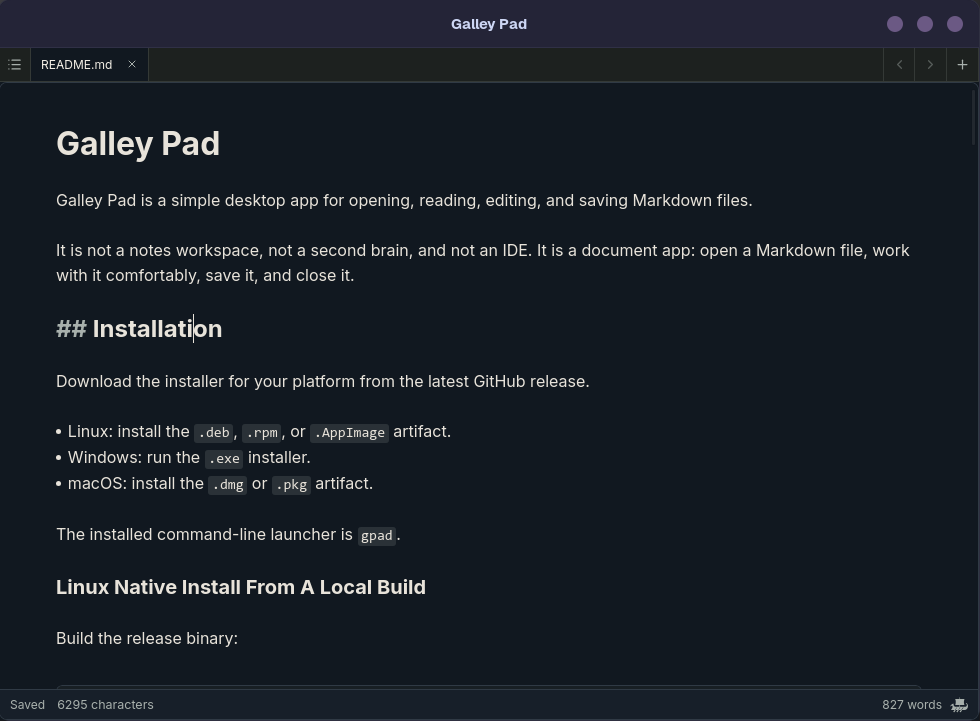

# Galley Pad

[](https://github.com/InkyQuill/galley-pad/releases)
[](https://github.com/InkyQuill/galley-pad/actions/workflows/release-please.yml)
[](https://github.com/InkyQuill/galley-pad/actions/workflows/build-release.yml)


Galley Pad is a desktop Markdown editor for people who want to work with plain `.md` files directly.

It is not a notes workspace, not a second brain, and not an IDE. It is a document app: open a Markdown file, edit it comfortably, save it, and close it.



## What It Does

- Opens `.md` and `.markdown` files from the file manager, desktop launcher, command line, or a file drop. Reopen a recent document from **File → Open Recent**.
- Provides a focused Markdown editing surface powered by Galley Editor.
- Saves normal files on disk instead of hiding content in a workspace database.
- Opens multiple documents in tabs or separate windows and switches to the existing tab when the same file is requested again.
- Supports creating a new file by opening a path that does not exist yet.
- Provides native desktop packaging for Linux, Windows, and macOS.

## Install

Download the installer for your platform from the latest GitHub release.

- Linux: install the `.deb`, `.rpm`, or `.AppImage` artifact.
- Windows: run the `.exe` installer.
- macOS: install the `.pkg` artifact for your processor architecture.

The installed command-line launcher is `gpad`.

## Usage

Open an existing Markdown file:

```bash
gpad notes.md
```

Open multiple files:

```bash
gpad one.md two.markdown
```

Create a new file by opening a path that does not exist yet:

```bash
gpad new-draft.md
```

Relative paths are resolved from the directory where `gpad` is run. Absolute paths stay absolute. The file is created on disk when it is saved.

File-manager opens require an existing file. Use `gpad --open-existing file.md`
when launching from scripts that should treat a missing path as an error.
Each open window has its own crash-recovery snapshot. It stores text for
unsaved edits and reloads saved tabs from disk. Galley Pad displays a notice
when it restores unsaved edits. Closing a window clears its snapshot, and
quitting asks about unsaved work in every open window.
Changes to application settings are shared across windows.

Galley Pad opens UTF-8 files and UTF-16 files with a byte-order mark. If Galley Pad
reports an unsupported encoding for a legacy Cyrillic file, choose **Open as
Windows-1251** in the error banner. Saving preserves the document’s encoding
and line endings.

### Reading and navigation

Use the editor footer to switch between **Live Preview**, **Source**, and
**Preview**. Open the table of contents from the footer or press
**Ctrl+Shift+O** (**Cmd+Shift+O** on macOS). Choose a heading to jump to it.
Settings controls reading width, spellcheck, and whether HTTPS images load.
Relative raster images and links to Markdown or text files resolve within the
document's directory. Hold Ctrl or Cmd when activating a link in the editor.

Use **Ctrl+Tab** to switch tabs and **Ctrl+W** (**Cmd+W** on macOS) to close
the current tab. **Ctrl+Shift+T** (**Cmd+Shift+T** on macOS) reopens the
last file closed in the current window. Drag tabs to reorder them, or use the
tab context menu. Changing the open mode applies to new documents and leaves
the current tabs open.

## Local Development

Install and activate project toolchains:

```bash
mise install
```

Install dependencies:

```bash
bun install
```

Run the desktop app in development:

```bash
bun run tauri:dev
```

Run the main checks:

```bash
bun run lint
bun run test:coverage
bun run test:scripts
cargo test --manifest-path src-tauri/Cargo.toml
bun run build
```

Run the local verification suite:

```bash
bunx playwright install chromium
mise run verify
```

CI also tests WebKit. On a supported Playwright host, run it locally with
`bunx playwright install webkit` and `bun run test:integration --project=webkit`.

Build release installers locally:

```bash
bun run tauri -- build
```

On Linux, Tauri produces `.deb`, `.rpm`, and `.AppImage` artifacts when the platform bundling tools are available. On macOS, `bun run macos:pkg -- --release` builds the `.pkg` installer after the `.app` bundle is built.

## Linux Native Install From A Local Build

Build Linux packages:

```bash
bun run tauri -- build --bundles deb,rpm
```

Install the generated package for your distribution from `src-tauri/target/release/bundle/`.

For a user-local install without a distro package, copy the release binary and desktop metadata into the XDG user prefix:

```bash
install -Dm755 src-tauri/target/release/gpad ~/.local/bin/gpad
install -Dm644 src-tauri/icons/icon.png ~/.local/share/icons/hicolor/512x512/apps/gpad.png
```

Create a desktop entry at `~/.local/share/applications/net.inkyquill.GalleyPad.desktop`. In the desktop file snippet, set `Exec` to the absolute path where `gpad` is installed:

```ini
[Desktop Entry]
Type=Application
Name=Galley Pad
Comment=A simple desktop Markdown editor powered by Galley.
Exec=/replace/with/absolute/path/to/gpad --open-existing %F
Icon=gpad
Terminal=false
StartupWMClass=gpad
Categories=Utility;TextEditor;
MimeType=text/markdown;text/x-markdown;
Keywords=markdown;editor;text;
```

Then refresh desktop metadata:

```bash
update-desktop-database ~/.local/share/applications
gtk-update-icon-cache -q -t -f ~/.local/share/icons/hicolor
xdg-mime default net.inkyquill.GalleyPad.desktop text/markdown
xdg-mime default net.inkyquill.GalleyPad.desktop text/x-markdown
```

## Stack

- Tauri for the desktop shell and native file integration
- React for app UI and document state
- Galley Editor for Markdown editing and inline preview
- Galley Themes (`@inkyquill/galley-themes`) for the shared built-in theme catalog and CSS variable tokens
- Rust for filesystem, window lifecycle, dialogs, and platform integration

## Documentation

- [Vision](docs/vision.md)
- [Product principles](docs/product-principles.md)
- [Architecture](docs/architecture.md)
- [Roadmap](docs/roadmap.md)
- [Stage plans](docs/plans/)
- [Galley Editor integration notes](docs/reference/galley-editor.md)

## License

Galley Pad is released under the MIT License. See `LICENSE`.

## Releases

Releases use release-please. Conventional Commits on `main` update a release PR;
`fix` (including editor dependency fixes) produces a patch and `feat` a minor release.
The release PR updates `version.txt`, the changelog and manifest; the workflow then
synchronizes package, Cargo and Tauri versions and explicitly dispatches CI on that
branch. Enable GitHub Actions permission to create pull requests in repository settings.

Merging the release PR creates a draft GitHub release, pins the version tag and
dispatches installer builds with the tag, exact commit SHA, and numeric draft ID.
All platforms build that immutable commit and upload to the same draft. The
workflow publishes it once all seven installers are present. AUR publication follows if its SSH secret is configured and requires
a preverified AUR host key in `AUR_SSH_KNOWN_HOSTS`; missing host trust fails the
publish step instead of trusting a live network scan.

To retry installer publication, dispatch `build-release.yml` with the existing
`tag`, full `sha`, and numeric `release_id` of the intended draft. Assets already
uploaded to that draft are reused. Once the current version is tagged, dispatch
`release-please.yml` to refresh a release PR. Neither
workflow automatically merges PRs. `ci.yml` runs tests, browser integration, the build,
and release-version consistency checks on normal PRs and explicit release-PR dispatches.
